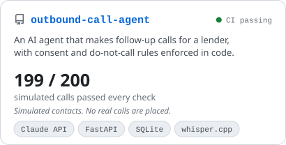
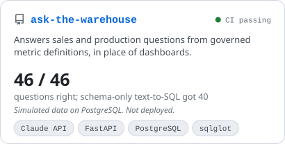
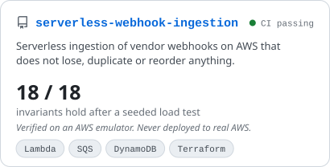
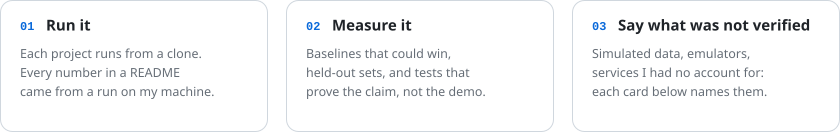

<!-- Generated by build.py from profile.toml. Edit those two files, not this one. -->

<picture><source media="(prefers-color-scheme: dark)" srcset="assets/hero-dark.svg"></picture>

<a href="https://linusdominic.github.io"><b>Portfolio</b></a> &nbsp;·&nbsp; <a href="https://www.linkedin.com/in/linus-dominic"><b>LinkedIn</b></a>

### AI engineering

<a href="https://github.com/linusdominic/outbound-call-agent"><picture><source media="(prefers-color-scheme: dark)" srcset="assets/card-outbound-call-agent-dark.svg"></picture></a>
<a href="https://github.com/linusdominic/sales-call-qa"><picture><source media="(prefers-color-scheme: dark)" srcset="assets/card-sales-call-qa-dark.svg"></picture></a>
<a href="https://github.com/linusdominic/ask-the-warehouse"><picture><source media="(prefers-color-scheme: dark)" srcset="assets/card-ask-the-warehouse-dark.svg"></picture></a>
<a href="https://github.com/linusdominic/vectorless-rag-benchmark"><picture><source media="(prefers-color-scheme: dark)" srcset="assets/card-vectorless-rag-benchmark-dark.svg"></picture></a>
<a href="https://github.com/linusdominic/agentic-docs-assistant"><picture><source media="(prefers-color-scheme: dark)" srcset="assets/card-agentic-docs-assistant-dark.svg"></picture></a>

### Data platforms

<a href="https://github.com/linusdominic/lakehouse-cdc-streaming"><picture><source media="(prefers-color-scheme: dark)" srcset="assets/card-lakehouse-cdc-streaming-dark.svg"></picture></a>
<a href="https://github.com/linusdominic/reconkit"><picture><source media="(prefers-color-scheme: dark)" srcset="assets/card-reconkit-dark.svg"></picture></a>
<a href="https://github.com/linusdominic/mortgage-metrics-platform"><picture><source media="(prefers-color-scheme: dark)" srcset="assets/card-mortgage-metrics-platform-dark.svg"></picture></a>
<a href="https://github.com/linusdominic/serverless-webhook-ingestion"><picture><source media="(prefers-color-scheme: dark)" srcset="assets/card-serverless-webhook-ingestion-dark.svg"></picture></a>

### How I work

<picture><source media="(prefers-color-scheme: dark)" srcset="assets/principles-dark.svg"></picture>

### What I work with

<picture><source media="(prefers-color-scheme: dark)" srcset="assets/stack-dark.svg"></picture>

<b>All of this as plain text</b>, with each project's full caveats

### Data platforms

Four repositories, one domain (lending), each runnable from a clone. Every number in
their READMEs comes from a run on my own machine, and each README lists what was not
verified.

| Repository | What it is | Stack |
| --- | --- | --- |
| [lakehouse-cdc-streaming](https://github.com/linusdominic/lakehouse-cdc-streaming) | Change data capture from a loan-servicing Postgres into Iceberg, with a harness that proves the lakehouse still matches the source after duplicates, replays, a schema change and a job killed mid-batch | Debezium, Kafka API (Redpanda), Spark Structured Streaming, Iceberg, Trino, dbt, Terraform |
| [reconkit](https://github.com/linusdominic/reconkit) | A Python tool that diffs tables across databases by checksum bisection, so only disagreeing key ranges are downloaded, and checks tables against data contracts in CI | Python, PostgreSQL, DuckDB, warehouse SQL dialects, Airflow and Dagster hooks |
| [mortgage-metrics-platform](https://github.com/linusdominic/mortgage-metrics-platform) | Batch platform on public HMDA mortgage data: idempotent backfills, a Kimball star with enforced contracts, metrics defined once in a semantic layer, and an MCP server that lets AI agents query those metrics and nothing else | Airflow 3, dbt, MetricFlow, DuckDB, MCP |
| [serverless-webhook-ingestion](https://github.com/linusdominic/serverless-webhook-ingestion) | Serverless ingestion of vendor webhooks on AWS: verify the signature, archive before acknowledging, then process idempotently and in order, with a seeded load test and a verifier that checks 18 invariants. Runs on a local AWS emulator; not deployed to a real account | API Gateway, Lambda, SQS, DynamoDB, S3, Glue, Athena, Step Functions, Terraform |

### AI engineering

Five repositories on LLM systems, held to the same rule: what the README claims was run,
and what was not run is listed.

| Repository | What it is | Stack |
| --- | --- | --- |
| [agentic-docs-assistant](https://github.com/linusdominic/agentic-docs-assistant) | A support agent that answers questions from a documentation set and files a ticket only after a human approves it. Retrieval runs on pgvector, the agent's state is checkpointed to Postgres so a paused run can resume, and replies stream over HTTP. Run locally against a live model and in CI with a scripted one; the Cloud Run deployment is a reference and was not run | LangGraph, FastAPI, PostgreSQL + pgvector, Docker, Cloud Run |
| [vectorless-rag-benchmark](https://github.com/linusdominic/vectorless-rag-benchmark) | "Vectorless" RAG, where a model navigates a document's outline instead of searching a vector index, built and measured against BM25, dense and hybrid retrieval on Regulation Z (Truth in Lending). With index summaries it ranked the right paragraph first on 95% of 60 questions against 75% for hybrid search, at about three seconds a query; the answer-accuracy gap was not statistically significant. The questions are model-written and only ten were checked by hand | Python, Claude API, BM25, fastembed, eCFR, GitHub Actions |
| [ask-the-warehouse](https://github.com/linusdominic/ask-the-warehouse) | A chat assistant that answers sales and production questions from governed metric definitions over near-real-time data, in place of dashboards, with scheduled digests and threshold alerts that a person approves. Evaluated on 46 hand-written questions against two text-to-SQL baselines: it scored 46, text-to-SQL given the same definitions also scored 46, and text-to-SQL given only the schema scored 40. Simulated data on PostgreSQL; not deployed | Python, Claude API, FastAPI, PostgreSQL, sqlglot, Docker, GitHub Actions |
| [sales-call-qa](https://github.com/linusdominic/sales-call-qa) | Grades recorded sales calls against a call script and shows meaningful and non-meaningful calls per loan officer, with a quote and a timestamp behind every verdict. Recordings are transcribed locally with whisper.cpp, and personal details are masked before a model sees them. On 160 held-out calls the grader got every call's outcome and every meaningful-or-not decision right; 4 of the 18 compliance flags it raised were false, all from one speech-recognition error. The calls are synthetic and the voices are text-to-speech; not deployed | Python, Claude API, whisper.cpp, FastAPI, GitHub Actions |
| [outbound-call-agent](https://github.com/linusdominic/outbound-call-agent) | An AI agent that makes follow-up calls for a mortgage lender: it qualifies the contact and books a time with a loan officer, transfers the call or schedules a callback. Consent, calling hours, the do-not-call list and the opening disclosures are enforced in code, and a browser page lets you talk to it by voice. On 200 held-out simulated contacts, including ones that push for a rate or a promise of approval, it passed every check on 199 calls; the same model with the rules only in its prompt passed 193, a difference that is not statistically significant. It can be connected to ElevenLabs, Vapi and Retell through adapters that were not run against the live services. No real calls are placed and the contacts are simulated | Python, Claude API, FastAPI, SQLite, whisper.cpp, GitHub Actions |

### What I work with

Python, SQL · Redshift, Databricks (Delta Lake, Unity Catalog), Snowflake, BigQuery,
PostgreSQL · Airflow, dbt, Spark, Kafka, AWS Glue · Terraform, Docker, GitHub Actions ·
LangGraph, FastAPI, pgvector, LLM evaluation

This page is built from <a href="profile.toml">profile.toml</a> by <a href="build.py">build.py</a> and rebuilt daily by a <a href=".github/workflows/build.yml">GitHub Action</a>, so the CI lights are current. Every image is a file in this repository.

