<!-- Generated by build.py from profile.toml and details.md. Edit those three files, not this one. -->

<picture><source media="(prefers-color-scheme: dark)" srcset="assets/hero-dark.svg"></picture>

<a href="https://linusdominic.github.io"><b>Portfolio</b></a> &nbsp;·&nbsp; <a href="https://www.linkedin.com/in/linus-dominic"><b>LinkedIn</b></a>

### AI engineering

<a href="https://github.com/linusdominic/outbound-call-agent"><picture><source media="(prefers-color-scheme: dark)" srcset="assets/card-outbound-call-agent-dark.svg"></picture></a>
<a href="https://github.com/linusdominic/sales-call-qa"><picture><source media="(prefers-color-scheme: dark)" srcset="assets/card-sales-call-qa-dark.svg">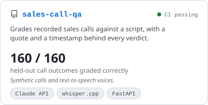</picture></a>
<a href="https://github.com/linusdominic/ask-the-warehouse"><picture><source media="(prefers-color-scheme: dark)" srcset="assets/card-ask-the-warehouse-dark.svg"></picture></a>
<a href="https://github.com/linusdominic/vectorless-rag-benchmark"><picture><source media="(prefers-color-scheme: dark)" srcset="assets/card-vectorless-rag-benchmark-dark.svg">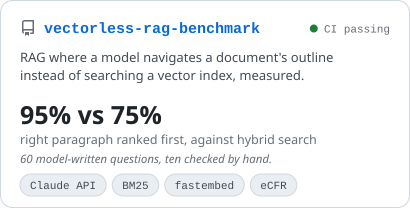</picture></a>
<a href="https://github.com/linusdominic/agentic-docs-assistant"><picture><source media="(prefers-color-scheme: dark)" srcset="assets/card-agentic-docs-assistant-dark.svg">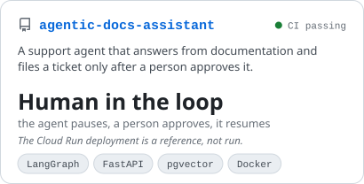</picture></a>
<a href="https://github.com/linusdominic/pipeline-triage-bench"><picture><source media="(prefers-color-scheme: dark)" srcset="assets/card-pipeline-triage-bench-dark.svg">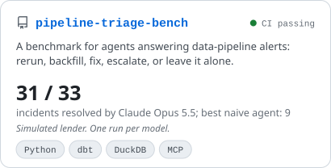</picture></a>

### Data platforms

<a href="https://github.com/linusdominic/airflow-migration-template"><picture><source media="(prefers-color-scheme: dark)" srcset="assets/card-airflow-migration-template-dark.svg">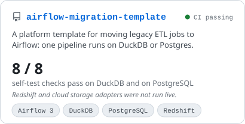</picture></a>
<a href="https://github.com/linusdominic/lakehouse-cdc-streaming"><picture><source media="(prefers-color-scheme: dark)" srcset="assets/card-lakehouse-cdc-streaming-dark.svg">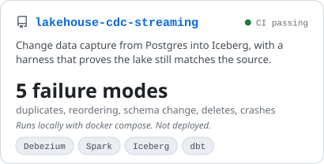</picture></a>
<a href="https://github.com/linusdominic/reconkit"><picture><source media="(prefers-color-scheme: dark)" srcset="assets/card-reconkit-dark.svg">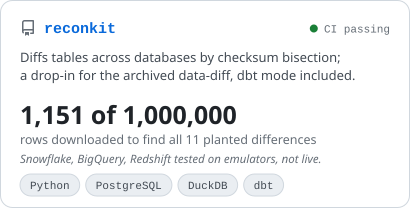</picture></a>
<a href="https://github.com/linusdominic/mortgage-metrics-platform"><picture><source media="(prefers-color-scheme: dark)" srcset="assets/card-mortgage-metrics-platform-dark.svg">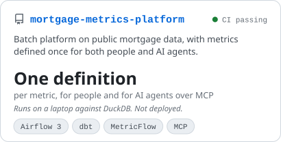</picture></a>
<a href="https://github.com/linusdominic/serverless-webhook-ingestion"><picture><source media="(prefers-color-scheme: dark)" srcset="assets/card-serverless-webhook-ingestion-dark.svg"></picture></a>
<a href="https://github.com/linusdominic/open-lending-data"><picture><source media="(prefers-color-scheme: dark)" srcset="assets/card-open-lending-data-dark.svg">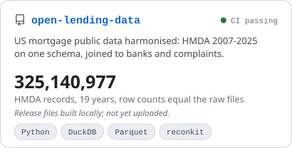</picture></a>
<a href="https://github.com/linusdominic/nosql-for-data-engineers"><picture><source media="(prefers-color-scheme: dark)" srcset="assets/card-nosql-for-data-engineers-dark.svg">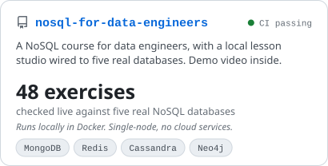</picture></a>

### How I work

<picture><source media="(prefers-color-scheme: dark)" srcset="assets/principles-dark.svg"></picture>

### What I work with

<picture><source media="(prefers-color-scheme: dark)" srcset="assets/stack-dark.svg">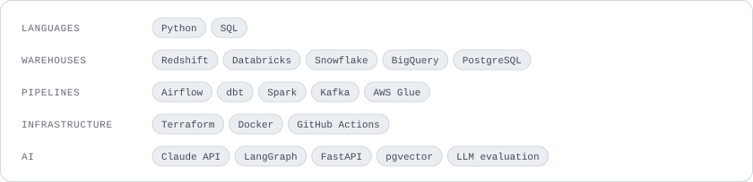</picture>

<b>All of this as plain text</b>, with each project's full caveats

### Data platforms

Seven repositories, one domain (lending), each runnable from a clone. Every number in
their READMEs comes from a run on my own machine, and each README lists what was not
verified.

| Repository | What it is | Stack |
| --- | --- | --- |
| [airflow-migration-template](https://github.com/linusdominic/airflow-migration-template) | A data platform template for migrating legacy ETL jobs (Talend and the like) to Airflow: pipelines that do not know their scheduler, warehouse adapters so the same pipeline runs on DuckDB, PostgreSQL or Redshift, tests for re-runs and backfills, and a self-test for any environment. Redshift and cloud storage were not run live | Airflow 3, DuckDB, PostgreSQL, Redshift, Jinja SQL, fsspec |
| [lakehouse-cdc-streaming](https://github.com/linusdominic/lakehouse-cdc-streaming) | Change data capture from a loan-servicing Postgres into Iceberg, with a harness that proves the lakehouse still matches the source after duplicates, replays, a schema change and a job killed mid-batch | Debezium, Kafka API (Redpanda), Spark Structured Streaming, Iceberg, Trino, dbt, Terraform |
| [reconkit](https://github.com/linusdominic/reconkit) | A Python tool that diffs tables across databases by checksum bisection, so only disagreeing key ranges are downloaded, and checks tables against data contracts in CI. `reconkit data-diff` is a drop-in for the archived data-diff command line and its dbt mode, checked against the expected output in data-diff's own test suite. On a million-row Postgres table against its DuckDB copy it found all 11 planted differences in about a second, downloading 1,151 rows. Snowflake, BigQuery and Redshift are tested against local emulators, not live accounts | Python, PostgreSQL, DuckDB, dbt, Snowflake, BigQuery and Redshift dialects, Airflow and Dagster hooks |
| [mortgage-metrics-platform](https://github.com/linusdominic/mortgage-metrics-platform) | Batch platform on public HMDA mortgage data: idempotent backfills, a Kimball star with enforced contracts, metrics defined once in a semantic layer, and an MCP server that lets AI agents query those metrics and nothing else | Airflow 3, dbt, MetricFlow, DuckDB, MCP |
| [serverless-webhook-ingestion](https://github.com/linusdominic/serverless-webhook-ingestion) | Serverless ingestion of vendor webhooks on AWS: verify the signature, archive before acknowledging, then process idempotently and in order, with a seeded load test and a verifier that checks 18 invariants. Runs on a local AWS emulator; not deployed to a real account | API Gateway, Lambda, SQS, DynamoDB, S3, Glue, Athena, Step Functions, Terraform |
| [open-lending-data](https://github.com/linusdominic/open-lending-data) | A reproducible pipeline that puts US mortgage-lending public data on one validated schema: 325 million HMDA records for 2007-2025, the lenders behind them matched to FDIC quarterly bank financials, and 467,257 CFPB mortgage complaints matched to lenders by name. 630 checks: row counts equal the raw files in every year, a SQL port of the FFIEC's derived race, ethnicity and sex fields reproduces all 137.7 million published values, reconkit finds no difference between the raw 2023 file and the table, and published totals are compared with citations, mismatches explained. The 13 GB of Parquet files are published as a GitHub release with checksums | Python, DuckDB, Parquet, reconkit, FFIEC, CFPB and FDIC APIs, GitHub Actions |
| [nosql-for-data-engineers](https://github.com/linusdominic/nosql-for-data-engineers) | A hands-on course in NoSQL for data engineers who know SQL and Python: MongoDB, Redis, Cassandra, DynamoDB Local and Neo4j in Docker. `make studio` opens a local lesson studio: the chapters on one side, live consoles on the other (mongosh, redis-cli, CQL, PartiQL, Cypher, DuckDB SQL), and 48 exercises checked against the databases themselves, with a [3-minute demo video](https://linusdominic.github.io/nosql-for-data-engineers/media/studio-demo.mp4). It covers what a data engineer actually does with these stores: flattening documents, schema drift, watermarks and change streams, idempotent stream consumers, token-range exports, single-table design and graph exports. The capstone moves a fictional lender's data from four of them into a Parquet lake and DuckDB marts; all 6 source-to-lake reconciliations pass and a re-run and a backfill change nothing. Single-node databases on one Mac; no cloud services | MongoDB, Redis, Cassandra, DynamoDB Local, Neo4j, DuckDB, Parquet, FastAPI, Docker, GitHub Actions |

### AI engineering

Six repositories on LLM systems, held to the same rule: what the README claims was run,
and what was not run is listed.

| Repository | What it is | Stack |
| --- | --- | --- |
| [agentic-docs-assistant](https://github.com/linusdominic/agentic-docs-assistant) | A support agent that answers questions from a documentation set and files a ticket only after a human approves it. Retrieval runs on pgvector, the agent's state is checkpointed to Postgres so a paused run can resume, and replies stream over HTTP. Run locally against a live model and in CI with a scripted one; the Cloud Run deployment is a reference and was not run | LangGraph, FastAPI, PostgreSQL + pgvector, Docker, Cloud Run |
| [pipeline-triage-bench](https://github.com/linusdominic/pipeline-triage-bench) | A benchmark for AI agents that answer data-pipeline alerts. Each of 33 incidents on a simulated lender's platform (DuckDB warehouse, dbt project in git, scheduler, monitors, vendor contracts) asks for a decision: rerun, backfill, fix the code or the monitor, escalate to the data's owner, quarantine, or leave it alone because it is a false alarm. It scores the decision, the root cause, the warehouse's end state and any unnecessary or destructive action, and serves its tools over MCP so any agent can be tested. Claude Opus 5.5 resolves 31 of 33 ($5.40) and Sonnet 5.5 28 of 33 ($1.52), neither taking an unnecessary or destructive action; their misses were mostly bank-holiday alerts where they changed a monitor instead of closing the alert as the runbook says. Closing every alert resolves 9, re-running everything 5. One run per model | Python, DuckDB, dbt, MCP, Claude API, GitHub Actions |
| [vectorless-rag-benchmark](https://github.com/linusdominic/vectorless-rag-benchmark) | "Vectorless" RAG, where a model navigates a document's outline instead of searching a vector index, built and measured against BM25, dense and hybrid retrieval on Regulation Z (Truth in Lending). With index summaries it ranked the right paragraph first on 95% of 60 questions against 75% for hybrid search, at about three seconds a query; the answer-accuracy gap was not statistically significant. The questions are model-written and only ten were checked by hand | Python, Claude API, BM25, fastembed, eCFR, GitHub Actions |
| [ask-the-warehouse](https://github.com/linusdominic/ask-the-warehouse) | A chat assistant that answers sales and production questions from governed metric definitions over near-real-time data, in place of dashboards, with scheduled digests and threshold alerts that a person approves. Evaluated on 46 hand-written questions against two text-to-SQL baselines: it scored 46, text-to-SQL given the same definitions also scored 46, and text-to-SQL given only the schema scored 40. Simulated data on PostgreSQL; not deployed | Python, Claude API, FastAPI, PostgreSQL, sqlglot, Docker, GitHub Actions |
| [sales-call-qa](https://github.com/linusdominic/sales-call-qa) | Grades recorded sales calls against a call script and shows meaningful and non-meaningful calls per loan officer, with a quote and a timestamp behind every verdict. Recordings are transcribed locally with whisper.cpp, and personal details are masked before a model sees them. On 160 held-out calls the grader got every call's outcome and every meaningful-or-not decision right; 4 of the 18 compliance flags it raised were false, all from one speech-recognition error. The calls are synthetic and the voices are text-to-speech; not deployed | Python, Claude API, whisper.cpp, FastAPI, GitHub Actions |
| [outbound-call-agent](https://github.com/linusdominic/outbound-call-agent) | An AI agent that makes follow-up calls for a mortgage lender: it qualifies the contact and books a time with a loan officer, transfers the call or schedules a callback. Consent, calling hours, the do-not-call list and the opening disclosures are enforced in code, and a browser page lets you talk to it by voice. On 200 held-out simulated contacts, including ones that push for a rate or a promise of approval, it passed every check on 199 calls; the same model with the rules only in its prompt passed 193, a difference that is not statistically significant. It can be connected to ElevenLabs, Vapi and Retell through adapters that were not run against the live services. No real calls are placed and the contacts are simulated | Python, Claude API, FastAPI, SQLite, whisper.cpp, GitHub Actions |

### What I work with

Python, SQL · Redshift, Databricks (Delta Lake, Unity Catalog), Snowflake, BigQuery,
PostgreSQL · Airflow, dbt, Spark, Kafka, AWS Glue · Terraform, Docker, GitHub Actions ·
LangGraph, FastAPI, pgvector, LLM evaluation

This page is built from <a href="profile.toml">profile.toml</a> by <a href="build.py">build.py</a> and rebuilt daily by a <a href=".github/workflows/build.yml">GitHub Action</a>, so the CI lights are current. Every image is a file in this repository.

